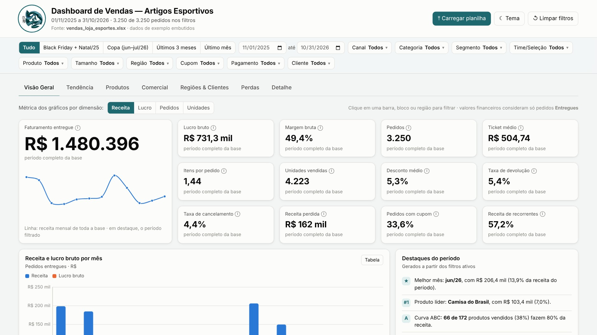
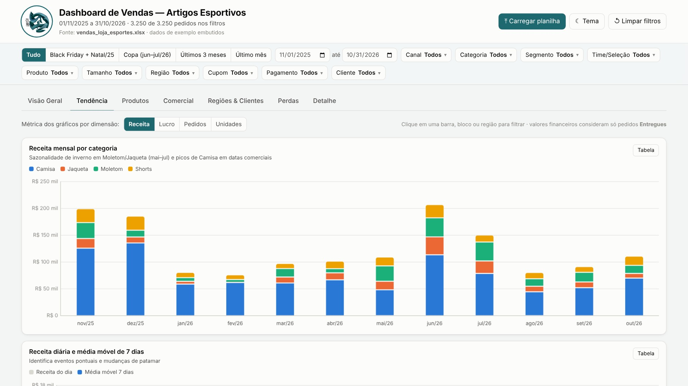
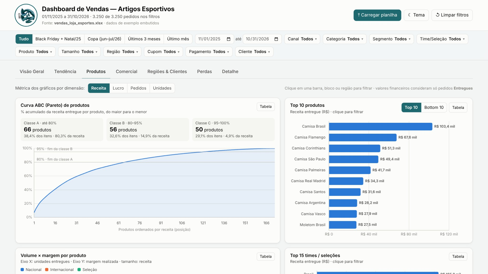
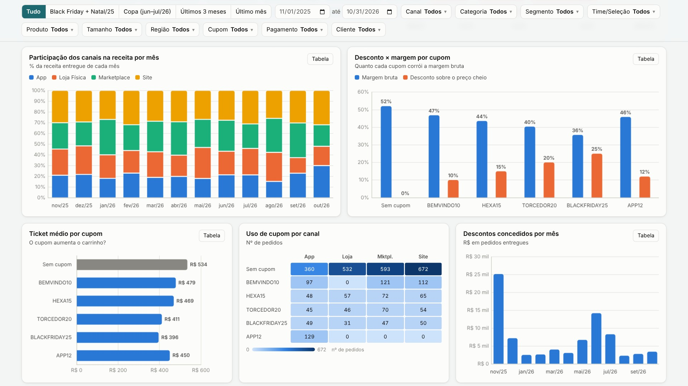
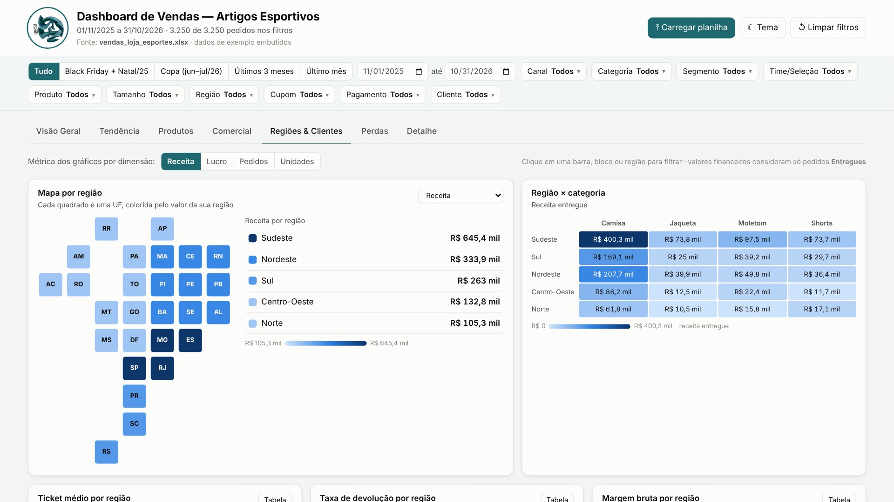

# Dashboard de Vendas — Loja de Artigos Esportivos

Dashboard interativo de vendas de uma loja de artigos esportivos (camisas, shorts, moletons e jaquetas de times e seleções), com 12 meses de pedidos (nov/2025 a out/2026). Tudo cabe em **um único arquivo HTML** que funciona offline e pode ser atualizado com uma planilha nova direto pelo navegador.

🔗 **Acesse o dashboard:** https://SEU-USUARIO.github.io/dashboard-vendas-esportes/

🎬 **Vídeo do tour (1:49):** [`video/Video_Dashboard_Vendas.mp4`](video/Video_Dashboard_Vendas.mp4)

## O que o dashboard mostra

| Aba | Conteúdo |
|---|---|
| **Visão Geral** | 13 indicadores com variação contra o período anterior, receita e lucro por mês, margem mensal, quebras por canal, categoria e região, e destaques escritos automaticamente |
| **Tendência** | Receita mensal por categoria, receita diária com média móvel de 7 dias, vendas por dia da semana e mapa de calor mês × dia |
| **Produtos** | Curva ABC (Pareto), top e bottom 10, volume × margem por produto, ranking de times e seleções, tamanhos e produtos sem venda |
| **Comercial** | Desempenho por canal, participação dos canais por mês, desconto × margem por cupom, ticket por cupom e formas de pagamento |
| **Regiões & Clientes** | Mapa por região, região × categoria, ticket, devolução e margem por região, novos × recorrentes e auditoria de uso do cupom de boas-vindas |
| **Perdas** | Status dos pedidos, receita perdida por mês e taxas de devolução e cancelamento por canal, categoria, tamanho, região e pagamento |
| **Detalhe** | Tabela de pedidos com busca, ordenação, paginação e exportação para CSV |

**Interatividade:** filtros de período (atalhos e datas) e de seleção múltipla em 10 dimensões, clique em qualquer gráfico para filtrar o dashboard inteiro, troca de métrica (receita, lucro, pedidos ou unidades), tabela de dados por gráfico e tema claro ou escuro.

## Alguns resultados da base

- **R$ 1,48 milhão** de faturamento entregue, com **margem bruta de 49,4%** e ticket médio de R$ 505.
- **Camisas** fazem 62% da receita. A Camisa do Brasil é o produto líder.
- **Sazonalidade:** picos em novembro e dezembro (Black Friday e Natal) e em **junho de 2026 (Copa do Mundo)**, o maior mês do período. Moletons e jaquetas sobem entre maio e julho.
- **Curva ABC:** 66 dos 172 produtos vendidos (38%) respondem por 80% da receita.
- **Cupons corroem margem:** com BLACKFRIDAY25, a margem cai para 35,7%, contra 52% nos pedidos sem cupom, e o ticket médio não sobe.
- **Perdas:** a loja física devolve 3,0% e cancela 0,6% dos pedidos, bem abaixo do marketplace (6,0% e 6,8%).

| | |
|---|---|
|  |  |
|  |  |

## Como usar

- **Online:** abra o link acima.
- **Offline:** baixe o `index.html` e abra no navegador com dois cliques. Não precisa de internet nem de instalar nada.

### Atualizar com uma planilha nova

Clique em **⤒ Carregar planilha** (ou arraste o arquivo para a página) e escolha um `.xlsx`, `.xls` ou `.csv`. O dashboard inteiro se recalcula: período, filtros, gráficos e indicadores. A última planilha carregada fica salva no navegador até você clicar em **voltar ao exemplo**.

A planilha não sai do seu computador: a leitura é feita no próprio navegador.

**Colunas da aba de vendas** (a ordem e o nome da aba não importam; acentos e maiúsculas são ignorados):

| Obrigatórias | Opcionais |
|---|---|
| Data, Canal, Categoria, Produto, Quantidade, Preço Unitário, Custo, Status | Pedido, Tamanho, Desconto, Cupom, Pagamento, Região, Cliente, Segmento, Time/Seleção |

Uma aba de catálogo com **Produto, Time/Seleção e Segmento** é opcional e permite listar os produtos que não venderam. A planilha de exemplo está em [`dados/vendas_loja_esportes.xlsx`](dados/vendas_loja_esportes.xlsx).

## Definições

- **Valores financeiros** (receita, lucro, margem, ticket) consideram só pedidos com status **Entregue**.
- **Receita** = quantidade × preço unitário − desconto.
- **Margem bruta** = (receita − custo do produto) ÷ receita. Não inclui frete, comissão de marketplace nem mídia.
- **Taxas de devolução e cancelamento** = pedidos devolvidos ou cancelados ÷ total de pedidos.
- **Comparação com o período anterior:** janela de mesmo tamanho imediatamente antes do período filtrado.

## Limitações

- **Dados fictícios:** a base é um exemplo, com preços e custos de premissa.
- **Sem cliente individual:** a base informa apenas se o cliente é novo ou recorrente, sem identificação. Por isso não há análises de coorte, RFM ou LTV.
- **Mapa esquemático:** a base traz a região, não o estado. Cada UF aparece com a cor da sua região.
- **Dados salvos por navegador:** a planilha carregada fica guardada só no navegador e no computador em que foi carregada.

## Como foi feito

O dashboard foi construído com apoio de IA (Claude), que gerou o código e as visualizações a partir das análises definidas para a base. Os indicadores foram conferidos contra a planilha original em Python (pandas), inclusive com filtros aplicados e com uma planilha alterada para testar a atualização.

**Tecnologias:** HTML, CSS e JavaScript em um único arquivo, com duas bibliotecas embutidas:

- [Chart.js](https://www.chartjs.org/) 4.6.1 (licença MIT), para os gráficos.
- [SheetJS](https://sheetjs.com/) 0.18.5 (licença Apache 2.0), para ler as planilhas no navegador.
